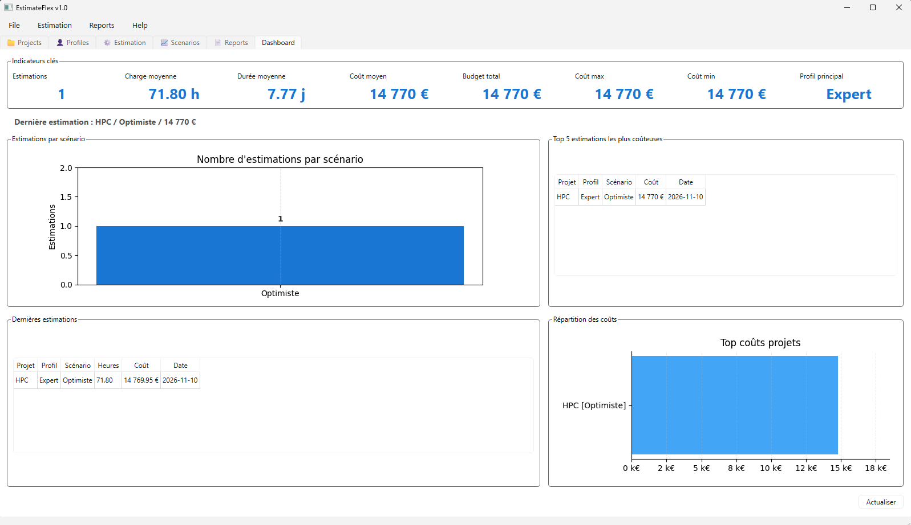
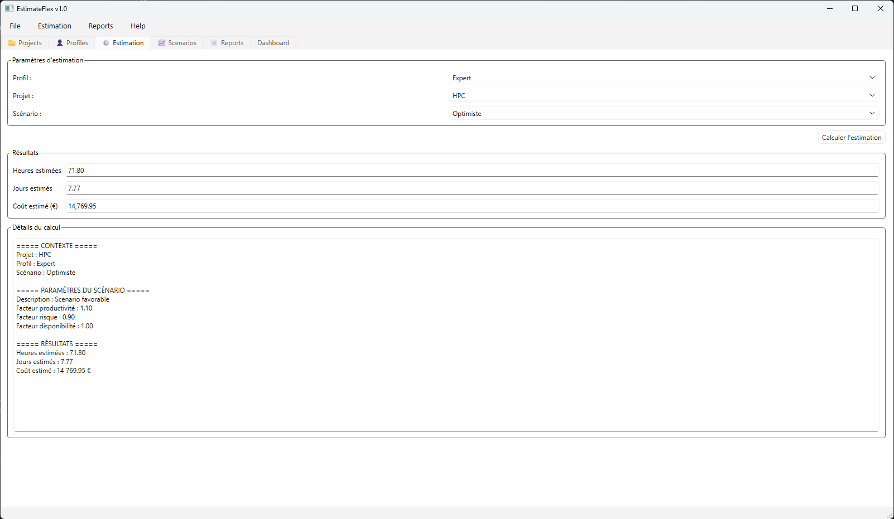
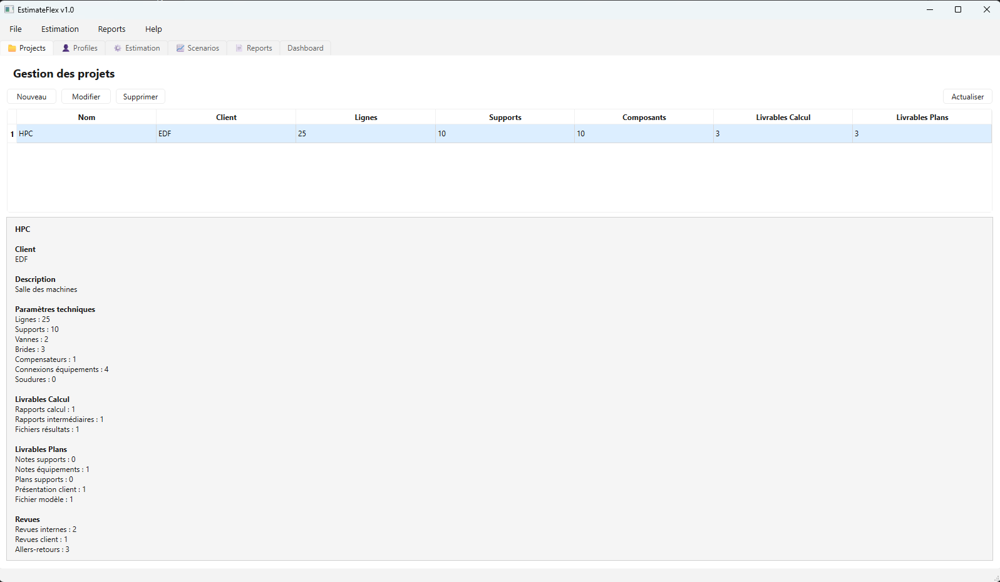
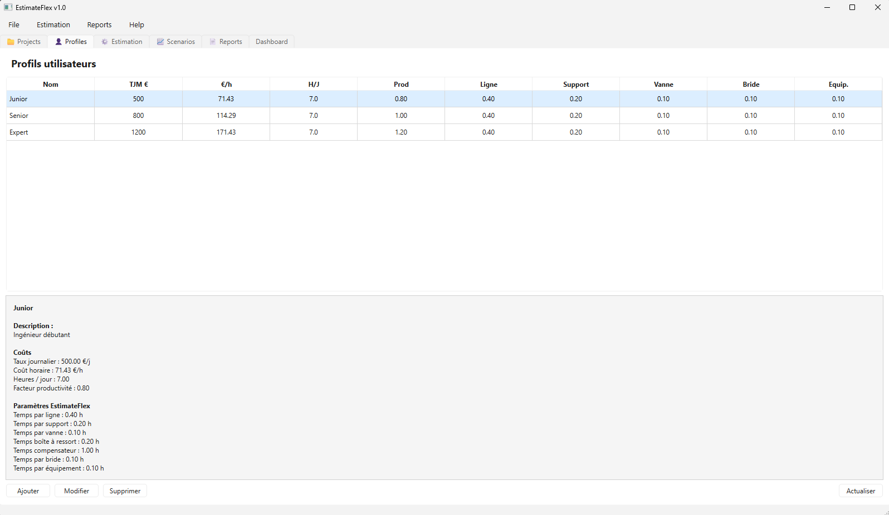
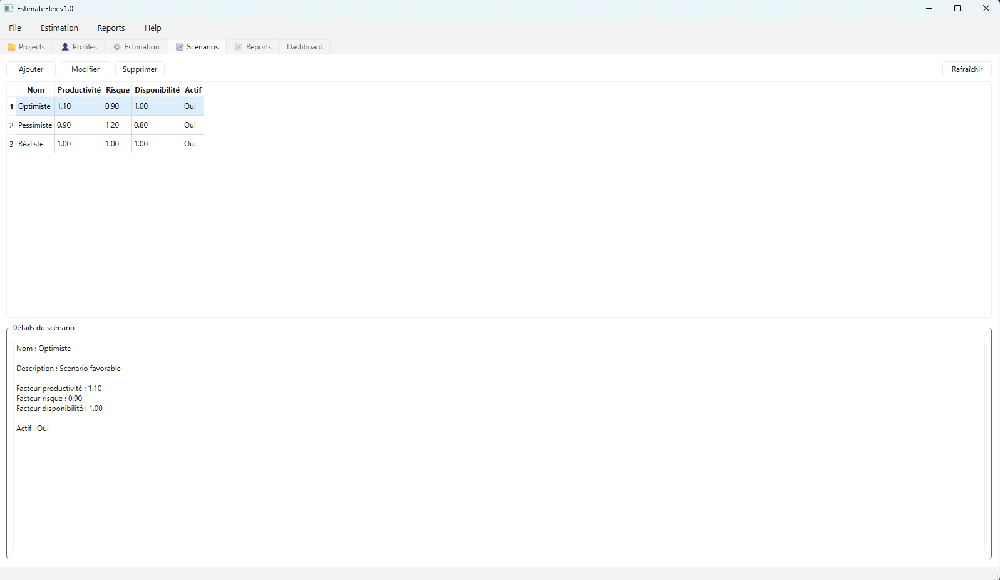
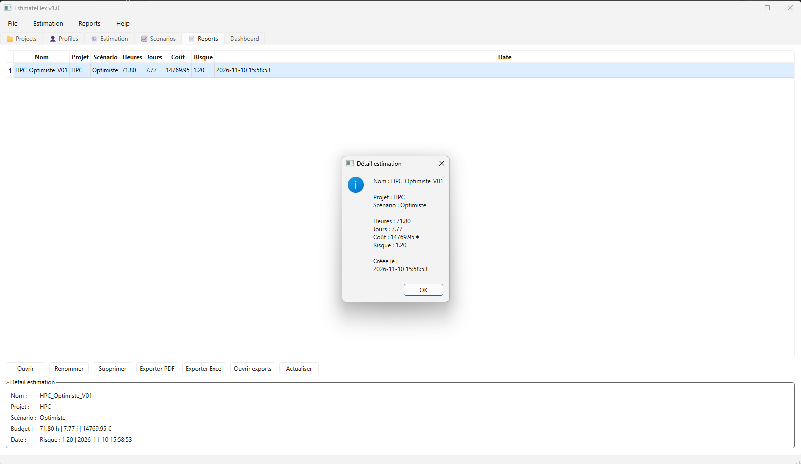

# EstimateFlex

EstimateFlex est une application desktop Python/PyQt6 destinée à la réalisation rapide d'estimations d'études techniques et d'ingénierie.

La solution permet de structurer les projets, appliquer différents profils de productivité et scénarios d'exécution, puis générer automatiquement des estimations de charge, durée et coût.

---

## Fonctionnalités

### Gestion des projets

- Création de projets
- Modification de projets
- Suppression de projets
- Contrôle de l'unicité des noms de projet
- Gestion des informations client

### Gestion des profils

- Profil Junior
- Profil Senior
- Profil Expert
- Paramètres de productivité personnalisables

### Gestion des scénarios

- Scénario Optimiste
- Scénario Réaliste
- Scénario Pessimiste
- Paramètres de risque et de productivité

### Estimations

- Calcul automatique des charges
- Calcul des durées
- Estimation des coûts
- Application des coefficients de complexité
- Prise en compte des profils et scénarios

### Rapports

- Historisation des estimations
- Consultation détaillée des résultats
- Renommage des rapports
- Suppression des rapports
- Classement des estimations

### Dashboard

- Indicateurs clés (KPI)
- Budget total
- Coût moyen
- Profil le plus utilisé
- Dernières estimations réalisées
- Top 5 des estimations les plus coûteuses
- Répartition des coûts
- Répartition des estimations par scénario

### Export

- Export PDF
- Export Excel

---

## Aperçu de l'application

### Dashboard



Vue synthétique des indicateurs clés, statistiques et estimations récentes.

### Estimation



Calcul des charges, durées et coûts selon le profil et le scénario sélectionnés.

### Projets



Gestion centralisée des projets et des informations client.

### Profils



Configuration des profils Junior, Senior et Expert.

### Scénarios



Gestion des scénarios Optimiste, Réaliste et Pessimiste.

### Rapports



Historique des estimations avec export PDF et Excel.
## Technologies

- Python 3.11+
- PyQt6
- SQLite
- Matplotlib
- OpenPyXL
- ReportLab

---

## Installation

### Clonage du dépôt

```bash
git clone https://github.com/christophepy/EstimateFlex.git
cd EstimateFlex
