# Architecture Report

Projet analysé : `src`

- Modules : **58**
- Classes : **52**
- Fonctions hors classe : **29**
- Relations modules : **0**
- Relations classes : **73**

## Architecture des modules

```mermaid
flowchart LR

    __init__["__init__"]
    config["config"]
    config_paths["config.paths"]
    core["core"]
    core_constants["core.constants"]
    core_estimation["core.estimation"]
    core_estimation_cost_engine["core.estimation.cost_engine"]
    core_estimation_duration_engine["core.estimation.duration_engine"]
    core_estimation_estimator["core.estimation.estimator"]
    core_formulas["core.formulas"]
    core_formulas_formulas["core.formulas.formulas"]
    core_risk["core.risk"]
    core_risk_risk_engine["core.risk.risk_engine"]
    core_scenario["core.scenario"]
    core_scenario_scenario_engine["core.scenario.scenario_engine"]
    main["main"]
    models["models"]
    models_app_settings["models.app_settings"]
    models_deliverables["models.deliverables"]
    models_estimation_result["models.estimation_result"]
    models_project["models.project"]
    models_project_parameters["models.project_parameters"]
    models_review_metrics["models.review_metrics"]
    models_scenario["models.scenario"]
    models_user_profile["models.user_profile"]
    persistence["persistence"]
    persistence_database["persistence.database"]
    persistence_estimation_repository["persistence.estimation_repository"]
    persistence_profile_repository["persistence.profile_repository"]
    persistence_project_repository["persistence.project_repository"]
    persistence_scenario_repository["persistence.scenario_repository"]
    persistence_settings_repository["persistence.settings_repository"]
    reports["reports"]
    reports_excel_report["reports.excel_report"]
    reports_pdf_report["reports.pdf_report"]
    reports_report_generator["reports.report_generator"]
    services["services"]
    services_estimation_service["services.estimation_service"]
    services_excel_export_service["services.excel_export_service"]
    services_pdf_export_service["services.pdf_export_service"]
    services_profile_service["services.profile_service"]
    services_project_service["services.project_service"]
    services_scenario_service["services.scenario_service"]
    services_settings_service["services.settings_service"]
    ui["ui"]
    ui_dashboard_tab["ui.dashboard_tab"]
    ui_estimation_tab["ui.estimation_tab"]
    ui_main_window["ui.main_window"]
    ui_profile_dialog["ui.profile_dialog"]
    ui_profiles_tab["ui.profiles_tab"]
    ui_project_dialog["ui.project_dialog"]
    ui_projects_tab["ui.projects_tab"]
    ui_reports_tab["ui.reports_tab"]
    ui_scenario_dialog["ui.scenario_dialog"]
    ui_scenarios_tab["ui.scenarios_tab"]
    ui_settings_dialog["ui.settings_dialog"]
    utils_exceptions["utils.exceptions"]
    utils_string_utils["utils.string_utils"]


```



## Architecture des classes

```mermaid
classDiagram

    class AppSettings {
        +company_name: str
        +currency: str
        +export_directory: str
        +hours_per_day: float
        +days_per_month: int
        +theme: str
        +font_size: int
        +show_dashboard_kpis: bool
        +show_dashboard_charts: bool
        +to_dict(self) dict
        +from_dict(cls, data: dict) 'AppSettings'
    }

    class CostBreakdown {
        +estimated_hours: float
        +estimated_days: float
        +daily_rate: float
        +base_cost: float
        +risk_factor: float
        +final_cost: float
    }

    class CostEngine {
        +HOURS_PER_DAY
        +calculate(cls, estimated_hours: float, daily_rate: float, risk_factor: float, hours_per_day: float | None) CostBreakdown
        +from_days(cls, estimated_days: float, daily_rate: float, risk_factor: float, hours_per_day: float | None) CostBreakdown
        +margin(selling_price: float, estimated_cost: float) float
        +margin_rate(selling_price: float, estimated_cost: float) float
    }

    class DashboardTab {
        +estimation_repository
        +settings_service
        +settings: self.settings_service.get
        +lbl_count: QLabel
        +lbl_hours: QLabel
        +lbl_days: QLabel
        +lbl_cost: QLabel
        +lbl_total_cost: QLabel
        +lbl_max_cost: QLabel
        +lbl_min_cost: QLabel
        +lbl_best_profile: QLabel
        +lbl_last_estimation: QLabel
        +figure: Figure
        +canvas: FigureCanvasQTAgg
        +cost_figure: Figure
        +cost_canvas: FigureCanvasQTAgg
        +top_table: QTableWidget
        +table: QTableWidget
        +__init__(self, estimation_repository, settings_service: SettingsService, parent)
        +_build_ui(self)
        +load_data(self)
        +_update_chart(self, reports)
        +_update_cost_chart(self, reports)
        +refresh(self)
    }

    class Database {
        +initialize(self) None
    }

    class DatabaseError {
    }

    class Deliverables {
        +rapport_calcul: int
        +rapport_calcul_intermediare: int
        +fichier_resultat: int
        +notes_supports: int
        +notes_equipements: int
        +plans_supports: int
        +presentation_client: int
        +fichier_modele: int
    }

    class DurationBreakdown {
        +estimated_hours: float
        +productivity_factor: float
        +risk_factor: float
        +availability_factor: float
        +adjusted_hours: float
        +estimated_days: float
    }

    class DurationEngine {
        +HOURS_PER_DAY
        +calculate(cls, estimated_hours: float, productivity_factor: float, risk_factor: float, availability_factor: float) DurationBreakdown
        +hours_to_days(cls, hours: float) float
        +days_to_hours(cls, days: float) float
        +working_weeks(estimated_days: float) float
    }

    class EnsureDirectories {
    }

    class EstimateFlexError {
    }

    class EstimationError {
    }

    class EstimationRepository {
        +save(self, estimation: EstimationResult) None
        +get_all(self) list[EstimationResult]
        +get_estimation(self, estimation_id: int) EstimationResult | None
        +delete_estimation(self, estimation_id: int) None
        +rename_estimation(self, estimation_id: int, new_name: str) None
        +duplicate_estimation(self, estimation_id: int) int | None
        +count(self) int
    }

    class EstimationResult {
        +id: int | None
        +estimation_nom: str
        +project_nom: str
        +profile_nom: str
        +scenario_nom: str
        +estimated_hours: float
        +estimated_days: float
        +estimated_cost: float
        +risk_factor: float
        +created_at: str
        +create(cls, project_nom: str, profile_nom: str, scenario_nom: str, estimated_hours: float, estimated_days: float, estimated_cost: float, risk_factor: float)
    }

    class EstimationService {
        +repository
        +estimator: Estimator
        +__init__(self, repository: EstimationRepository | None)
        +estimate(self, project: Project, profile: UserProfile, scenario: Scenario) EstimationResult
    }

    class EstimationTab {
        +settings_service
        +settings: self.settings_service.get
        +estimation_service: EstimationService
        +profile_service: ProfileService
        +project_service: ProjectService
        +scenario_service: ScenarioService
        +profile_combo: QComboBox
        +project_combo: QComboBox
        +scenario_combo: QComboBox
        +estimate_button: QPushButton
        +hours_edit: QLineEdit
        +days_edit: QLineEdit
        +cost_edit: QLineEdit
        +cost_label: QLabel
        +details_text: QTextEdit
        +__init__(self, settings_service, parent)
        +_build_ui(self)
        +_load_data(self)
        +calculate_estimation(self)
        +_display_details(self, project, profile, scenario, result)
        +_update_labels(self)
        +refresh(self)
    }

    class Estimator {
        +cost_engine: CostEngine
        +duration_engine: DurationEngine
        +risk_engine: RiskEngine
        +__init__(self)
        +estimate(self, project: Project, profile: UserProfile) EstimationResult
        +_calculate_hours(self, project: Project) float
    }

    class ExcelExportService {
        +export(report, file_path: str, currency: str) Path
        +_get_versioned_filename(output: Path) Path
    }

    class ExcelReport {
        +generate(estimation, output_file)
    }

    class MainWindow {
        +settings_service
        +settings: self.settings_service.get
        +estimation_repository: EstimationRepository
        +tabs: QTabWidget
        +projects_tab: ProjectsTab
        +profiles_tab: ProfilesTab
        +estimation_tab: EstimationTab
        +scenarios_tab: ScenariosTab
        +reports_tab: ReportsTab
        +dashboard_tab: DashboardTab
        +__init__(self, settings_service: SettingsService)
        +_create_ui(self)
        +_create_menu(self)
        +_create_statusbar(self)
        +run_estimation(self)
        +show_about(self)
        +on_tab_changed(self, index)
        +show_settings(self)
        +reload_settings(self)
        +closeEvent(self, event)
    }

    class NumericTableWidgetItem {
        +__lt__(self, other)
    }

    class PdfExportService {
        +export(report, file_path: str, currency: str) Path
        +_get_versioned_filename(output: Path) Path
    }

    class PdfReport {
        +generate(estimation, output_file)
    }

    class ProfileDialog {
        +profile
        +nom_edit: QLineEdit
        +description_edit: QTextEdit
        +taux_journalier_edit: QDoubleSpinBox
        +heures_par_jour_edit: QDoubleSpinBox
        +facteur_productivite_edit: QDoubleSpinBox
        +heure_par_ligne_edit: self._create_time_spin
        +heure_par_support_edit: self._create_time_spin
        +heure_par_vanne_edit: self._create_time_spin
        +heure_par_boite_a_ressort_edit: self._create_time_spin
        +heure_compensateur_edit: self._create_time_spin
        +heure_par_bride_edit: self._create_time_spin
        +heure_par_equipement_edit: self._create_time_spin
        +__init__(self, parent, profile)
        +_build_ui(self)
        +_create_time_spin(self)
        +_load_profile(self)
        +get_profile(self) UserProfile
    }

    class ProfileRepository {
        +create(profile: UserProfile) int
        +get_by_id(profile_id: int) UserProfile | None
        +get_all() list[UserProfile]
        +update(profile: UserProfile) bool
        +delete(profile_id: int) bool
        +count() int
        +get_by_name(nom: str) UserProfile | None
    }

    class ProfileService {
        +repository
        +__init__(self, repository: ProfileRepository | None)
        +create_profile(self, profile: UserProfile) int
        +update_profile(self, profile: UserProfile) bool
        +delete_profile(self, profile_id: int) bool
        +get_profile(self, profile_id: int) UserProfile | None
        +get_profile_by_nom(self, nom: str) UserProfile | None
        +get_all_profiles(self) list[UserProfile]
        +get_default_profile(self) UserProfile | None
        +set_default_profile(self) bool
        +validate_profile(self, profile: UserProfile) tuple[bool, list[str]]
        +duplicate_profile(self, profile_id: int, new_nom: str) int
        +count_profiles(self) int
    }

    class ProfilesTab {
        +settings_service
        +settings: self.settings_service.get
        +profile_service: ProfileService
        +profile_table: QTableWidget
        +details_label: QLabel
        +btn_add: QPushButton
        +btn_edit: QPushButton
        +btn_delete: QPushButton
        +btn_refresh: QPushButton
        +__init__(self, settings_service, parent)
        +_build_ui(self)
        +load_profiles(self)
        +on_profile_selected(self)
        +add_profile(self)
        +edit_profile(self)
        +delete_profile(self)
        +get_selected_profile(self)
        +_update_labels(self)
        +refresh(self)
    }

    class Project {
        +id: int | None
        +nom: str
        +client: str
        +description: str
        +profile_nom: str
        +budget: float
        +status: str
        +parameters: ProjectParameters
        +deliverables: Deliverables
        +reviews: ReviewMetrics
    }

    class ProjectDialog {
        +project
        +nom_edit: QLineEdit
        +client_edit: QLineEdit
        +description_edit: QTextEdit
        +nb_lignes_edit: QSpinBox
        +nb_supports_edit: QSpinBox
        +nb_vannes_edit: QSpinBox
        +nb_brides_edit: QSpinBox
        +nb_compensateur_edit: QSpinBox
        +nb_connexions_edit: QSpinBox
        +nb_soudures_edit: QSpinBox
        +rapport_calcul_edit: QSpinBox
        +rapport_inter_edit: QSpinBox
        +notes_supports_edit: QSpinBox
        +notes_equipements_edit: QSpinBox
        +plans_supports_edit: QSpinBox
        +presentation_client_edit: QSpinBox
        +fichier_modele_edit: QSpinBox
        +fichier_resultat_edit: QSpinBox
        +revues_internes_edit: QSpinBox
        +revues_client_edit: QSpinBox
        +aller_retour_edit: QSpinBox
        +__init__(self, project, parent)
        +_build_ui(self)
        +_load_project(self)
        +get_project(self)
    }

    class ProjectParameters {
        +nb_lignes: int
        +nb_supports: int
        +nb_vannes: int
        +nb_brides: int
        +nb_compensateur: int
        +nb_connexions_equipements: int
        +nb_soudures: int
    }

    class ProjectRepository {
        +storage_dir: Path
        +__init__(self, storage_dir: str | Path) None
        +_name_exists(self, project_nom: str) bool
        +save(self, project: Project) Project
        +delete(self, project_nom: str) bool
        +load(self, project_nom: str) Project
        +get_by_name(self, nom: str) Project | None
        +get_by_id(self, project_id: int) Project | None
        +get_all(self) list[Project]
        +exists(self, project_nom: str) bool
        +list_projects(self) list[str]
        +update(self, project: Project) Project
        +count(self) int
    }

    class ProjectService {
        +repository
        +__init__(self, repository: ProjectRepository | None)
        +create_project(self, project: Project) Project
        +update_project(self, project: Project) Project
        +delete_project(self, project_nom: str) bool
        +get_project(self, project_nom: str) Project | None
        +get_project_by_nom(self, nom: str) Project | None
        +get_all_projects(self) list[Project]
        +search_projects(self, keyword: str) list[Project]
        +count_projects(self) int
        +total_estimated_cost(self) float
        +total_estimated_days(self) float
        +total_estimated_hours(self) float
        +build_estimation_context(self, project_nom: str) dict
        +_validate_project(self, project: Project) None
        +dashboard_summary(self) dict
    }

    class ProjectsTab {
        +project_service: ProjectService
        +btn_new: QPushButton
        +btn_edit: QPushButton
        +btn_delete: QPushButton
        +btn_refresh: QPushButton
        +table: QTableWidget
        +details_label: QLabel
        +__init__(self, parent)
        +_build_ui(self)
        +load_projects(self)
        +get_selected_project(self)
        +create_project(self)
        +edit_project(self)
        +delete_project(self)
        +on_project_selected(self)
        +refresh(self)
    }

    class ReportGenerationError {
    }

    class ReportGenerator {
        +generate(report_type, estimation, output_file)
    }

    class ReportsTab {
        +estimation_repository
        +settings_service
        +settings: self.settings_service.get
        +pdf_export_service: PdfExportService
        +excel_export_service: ExcelExportService
        +reports_table: QTableWidget
        +open_btn: QPushButton
        +rename_btn: QPushButton
        +delete_btn: QPushButton
        +refresh_btn: QPushButton
        +open_exports_btn: QPushButton
        +pdf_btn: QPushButton
        +excel_btn: QPushButton
        +lbl_name: QLabel
        +lbl_project: QLabel
        +lbl_scenario: QLabel
        +lbl_budget: QLabel
        +lbl_date: QLabel
        +__init__(self, estimation_repository, settings_service: SettingsService, parent)
        +_build_ui(self)
        +load_reports(self)
        +_get_selected_report(self)
        +_update_details(self)
        +_open_report(self)
        +rename_report(self)
        +delete_report(self)
        +export_pdf(self)
        +export_excel(self)
        +open_exports_folder(self)
    }

    class ReviewMetrics {
        +nb_revues_internes: int
        +nb_revues_client: int
        +nb_aller_retour: int
    }

    class RiskEngine {
        +calculate(planning_risk: int, scope_risk: int, technical_risk: int) RiskResult
    }

    class RiskResult {
        <<dataclass>>
        +score: float
        +factor: float
    }

    class Scenario {
        +id: int | None
        +nom: str
        +description: str
        +facteur_productivite: float
        +facteur_risque: float
        +facteur_disponibilite: float
        +actif: bool
    }

    class ScenarioDialog {
        +scenario
        +nom_edit: QLineEdit
        +description_edit: QTextEdit
        +productivite_edit: QDoubleSpinBox
        +risque_edit: QDoubleSpinBox
        +disponibilite_edit: QDoubleSpinBox
        +actif_check: QCheckBox
        +__init__(self, parent, scenario)
        +_build_ui(self)
        +_load_scenario(self)
        +get_scenario(self) Scenario
    }

    class ScenarioEngine {
        +SCENARIOS
        +build(cls, base_hours: float, base_days: float, base_cost: float, scenario_type: ScenarioType) ScenarioResult
        +generate_all(cls, base_hours: float, base_days: float, base_cost: float) list[ScenarioResult]
        +best_case(scenarios: list[ScenarioResult]) ScenarioResult
        +worst_case(scenarios: list[ScenarioResult]) ScenarioResult
        +average_cost(scenarios: list[ScenarioResult]) float
    }

    class ScenarioRepository {
        +_name_exists(nom: str, exclude_id: int | None) bool
        +create(scenario: Scenario) int
        +get_by_id(scenario_id: int) Scenario | None
        +get_by_name(nom: str) Scenario | None
        +get_all() list[Scenario]
        +update(scenario: Scenario) bool
        +is_used(scenario_id: int) bool
        +delete(scenario_id: int) bool
        +count() int
    }

    class ScenarioResult {
        +scenario: str
        +estimated_hours: float
        +estimated_days: float
        +estimated_cost: float
        +effort_multiplier: float
        +risk_multiplier: float
    }

    class ScenarioService {
        +repository: ScenarioRepository
        +__init__(self)
        +get_all_scenarios(self) list[Scenario]
        +get_scenario(self, scenario_id: int) Scenario | None
        +get_by_name(self, nom: str) Scenario | None
        +create_scenario(self, scenario: Scenario) int
        +update_scenario(self, scenario: Scenario) None
        +delete_scenario(self, scenario_id: int) None
        +count(self) int
        +_validate_scenario(self, scenario: Scenario) None
    }

    class ScenarioType {
        <<enumeration>>
        +OPTIMISTIC
        +REALISTIC
        +PESSIMISTIC
    }

    class ScenariosTab {
        +service: ScenarioService
        +add_button: QPushButton
        +edit_button: QPushButton
        +delete_button: QPushButton
        +refresh_button: QPushButton
        +table: QTableWidget
        +details_text: QTextEdit
        +scenarios: self.service.get_all_scenarios
        +__init__(self, parent)
        +_build_ui(self)
        +load_scenarios(self)
        +get_selected_scenario(self)
        +add_scenario(self)
        +edit_scenario(self)
        +delete_scenario(self)
        +_show_details(self)
        +refresh(self)
    }

    class SettingsDialog {
        +settings_service
        +settings: self.settings_service.get
        +tabs: QTabWidget
        +company_edit: QLineEdit
        +currency_combo: QComboBox
        +export_directory_edit: QLineEdit
        +hours_per_day_spin: QDoubleSpinBox
        +days_per_month_spin: QSpinBox
        +theme_combo: QComboBox
        +font_size_spin: QSpinBox
        +dashboard_kpis_check: QCheckBox
        +dashboard_charts_check: QCheckBox
        +buttons: QDialogButtonBox
        +__init__(self, settings_service: SettingsService, parent)
        +_create_ui(self)
        +_load_settings(self)
        +_save(self)
    }

    class SettingsRepository {
        +data_dir: Path
        +file_path
        +__init__(self, data_dir: str | Path) None
        +load(self) AppSettings
        +save(self, settings: AppSettings) None
        +reset(self) AppSettings
    }

    class SettingsService {
        +persistence
        +__init__(self, repository: SettingsRepository) None
        +get(self) AppSettings
        +save(self, settings: AppSettings) None
        +reset(self) AppSettings
        +update(self, **kwargs) AppSettings
        +_validate(self, settings: AppSettings) None
    }

    class UserProfile {
        +id: int | None
        +nom: str
        +description: str
        +taux_journalier: float
        +heures_par_jour: float
        +facteur_productivite: float
        +heure_par_ligne: float
        +heure_par_support: float
        +heure_par_vanne: float
        +heure_par_boite_a_ressort: float
        +heure_compensateur: float
        +heure_par_bride: float
        +heure_par_equipement: float
        +heure_par_note_de_calcul: float
        +heure_par_presentation: float
        +heure_par_verification: float
    }

    class ValidationError {
    }

    CostEngine ..> CostBreakdown
    DurationEngine ..> DurationBreakdown
    Estimator *-- CostEngine
    Estimator *-- DurationEngine
    Estimator *-- RiskEngine
    Estimator ..> Project
    Estimator ..> EstimationResult
    Estimator ..> UserProfile
    RiskEngine ..> RiskResult
    ScenarioEngine ..> ScenarioResult
    ScenarioEngine ..> ScenarioType
    Project ..> ReviewMetrics
    Project ..> ProjectParameters
    Project ..> Deliverables
    EstimationRepository ..> EstimationResult
    ProfileRepository ..> UserProfile
    ProjectRepository ..> ReviewMetrics
    ProjectRepository ..> Project
    ProjectRepository ..> ProjectParameters
    ProjectRepository ..> Deliverables
    ScenarioRepository ..> Scenario
    SettingsRepository ..> AppSettings
    EstimationService *-- Estimator
    EstimationService ..> EstimationRepository
    EstimationService ..> Project
    EstimationService ..> EstimationResult
    EstimationService ..> Scenario
    EstimationService ..> UserProfile
    ProfileService ..> UserProfile
    ProfileService ..> ProfileRepository
    ProjectService ..> ProjectRepository
    ProjectService ..> Project
    ProjectService ..> ValidationError
    ScenarioService *-- ScenarioRepository
    ScenarioService ..> Scenario
    SettingsService ..> AppSettings
    SettingsService ..> SettingsRepository
    DashboardTab ..> SettingsService
    EstimationTab *-- EstimationService
    EstimationTab *-- ProfileService
    EstimationTab *-- ProjectService
    EstimationTab *-- ScenarioService
    MainWindow *-- EstimationRepository
    MainWindow *-- ProjectsTab
    MainWindow *-- ProfilesTab
    MainWindow *-- EstimationTab
    MainWindow *-- ScenariosTab
    MainWindow *-- ReportsTab
    MainWindow *-- DashboardTab
    MainWindow ..> SettingsService
    MainWindow ..> SettingsDialog
    ProfileDialog ..> UserProfile
    ProfilesTab *-- ProfileService
    ProfilesTab ..> ProfileDialog
    ProjectDialog ..> ReviewMetrics
    ProjectDialog ..> Project
    ProjectDialog ..> ProjectParameters
    ProjectDialog ..> Deliverables
    ProjectsTab *-- ProjectService
    ProjectsTab ..> ProjectDialog
    ReportsTab *-- PdfExportService
    ReportsTab *-- ExcelExportService
    ReportsTab ..> NumericTableWidgetItem
    ReportsTab ..> SettingsService
    ScenarioDialog ..> Scenario
    ScenariosTab *-- ScenarioService
    ScenariosTab ..> ScenarioDialog
    SettingsDialog ..> SettingsService
    SettingsDialog ..> AppSettings
    EstimateFlexError <|-- ValidationError
    EstimateFlexError <|-- DatabaseError
    EstimateFlexError <|-- EstimationError
    EstimateFlexError <|-- ReportGenerationError

```

## Modules

### `__init__`

Fichier : `__init__.py`

### `config`

Fichier : `config\__init__.py`

### `config.paths`

Fichier : `config\paths.py`

**Classes :**

- `EnsureDirectories`

### `core`

Fichier : `core\__init__.py`

### `core.constants`

Fichier : `core\constants.py`

### `core.estimation`

Fichier : `core\estimation\__init__.py`

### `core.estimation.cost_engine`

Fichier : `core\estimation\cost_engine.py`

**Imports :**

- `from dataclasses import dataclass`

**Classes :**

- `CostBreakdown`
- `CostEngine`

### `core.estimation.duration_engine`

Fichier : `core\estimation\duration_engine.py`

**Imports :**

- `from dataclasses import dataclass`

**Classes :**

- `DurationBreakdown`
- `DurationEngine`

### `core.estimation.estimator`

Fichier : `core\estimation\estimator.py`

**Imports :**

- `from src.core.estimation.cost_engine import CostEngine`
- `from src.core.estimation.duration_engine import DurationEngine`
- `from src.core.risk.risk_engine import RiskEngine`
- `from src.models.estimation_result import EstimationResult`
- `from src.models.project import Project`
- `from src.models.user_profile import UserProfile`

**Classes :**

- `Estimator`

### `core.formulas`

Fichier : `core\formulas\__init__.py`

### `core.formulas.formulas`

Fichier : `core\formulas\formulas.py`

**Imports :**

- `from src.models.deliverables import Deliverables`
- `from src.models.project_parameters import ProjectParameters`
- `from src.models.review_metrics import ReviewMetrics`
- `from src.models.user_profile import UserProfile`

**Fonctions :**

- `effort_lignes(nb_lignes: int, heure_par_ligne: float)`
- `effort_supports(nb_supports: int, heure_par_support: float)`
- `effort_vannes(nb_vannes: int, heure_par_vanne: float)`
- `effort_brides(nb_brides: int, heure_par_bride: float)`
- `effort_equipements(nb_connexions: int, heure_par_equipement: float)`
- `effort_rapport_calcul(nb_rapports: int, heure_par_note: float)`
- `effort_notes_supports(nb_notes: int, heure_par_note: float)`
- `effort_notes_equipements(nb_notes: int, heure_par_note: float)`
- `effort_plans_supports(nb_plans: int, heure_par_note: float)`
- `effort_presentation_client(nb_presentations: int, heure_par_presentation: float)`
- `effort_revue_interne(nb_revues: int, heure_par_verification: float)`
- `effort_revue_client(nb_revues: int, heure_par_verification: float)`
- `effort_aller_retour(nb_allers_retours: int, heure_par_verification: float)`
- `calcul_effort_modelisation(project: ProjectParameters, profile: UserProfile)`
- `calcul_effort_redaction(deliverables: Deliverables, profile: UserProfile)`
- `calcul_effort_verification(reviews: ReviewMetrics, profile: UserProfile)`
- `calcul_effort_total(effort_modelisation: float, effort_redaction: float, effort_verification: float)`
- `calcul_taux_horaire(profile: UserProfile)`
- `calcul_cout(effort_h: float, profile: UserProfile)`
- `calcul_cout_total(cout_modelisation: float, cout_redaction: float, cout_verification: float)`
- `calcul_estimation(project: ProjectParameters, deliverables: Deliverables, reviews: ReviewMetrics, profile: UserProfile)`

### `core.risk`

Fichier : `core\risk\__init__.py`

### `core.risk.risk_engine`

Fichier : `core\risk\risk_engine.py`

**Imports :**

- `from dataclasses import dataclass`

**Classes :**

- `RiskResult` — dataclass
- `RiskEngine`

### `core.scenario`

Fichier : `core\scenario\__init__.py`

### `core.scenario.scenario_engine`

Fichier : `core\scenario\scenario_engine.py`

**Imports :**

- `from dataclasses import dataclass`
- `from enum import StrEnum`

**Classes :**

- `ScenarioType` — Enum
- `ScenarioResult`
- `ScenarioEngine`

### `main`

Fichier : `main.py`

**Imports :**

- `from __future__ import annotations`
- `import logging`
- `import sys`
- `import traceback`
- `from PyQt6.QtWidgets import QApplication`
- `from PyQt6.QtWidgets import QMessageBox`
- `from src.config.paths import EnsureDirectories`
- `from src.persistence.database import Database`
- `from src.persistence.settings_repository import SettingsRepository`
- `from src.services.settings_service import SettingsService`
- `from src.ui.main_window import MainWindow`

**Fonctions :**

- `configure_logging()`
- `initialize_application()`
- `handle_exception(exc_type, exc_value, exc_traceback)`
- `main()`

### `models`

Fichier : `models\__init__.py`

### `models.app_settings`

Fichier : `models\app_settings.py`

**Imports :**

- `from dataclasses import dataclass`

**Classes :**

- `AppSettings`

### `models.deliverables`

Fichier : `models\deliverables.py`

**Imports :**

- `from dataclasses import dataclass`

**Classes :**

- `Deliverables`

### `models.estimation_result`

Fichier : `models\estimation_result.py`

**Imports :**

- `from dataclasses import dataclass`
- `from datetime import datetime`

**Classes :**

- `EstimationResult`

### `models.project`

Fichier : `models\project.py`

**Imports :**

- `from dataclasses import dataclass`
- `from dataclasses import field`
- `from .deliverables import Deliverables`
- `from .project_parameters import ProjectParameters`
- `from .review_metrics import ReviewMetrics`

**Classes :**

- `Project`

### `models.project_parameters`

Fichier : `models\project_parameters.py`

**Imports :**

- `from dataclasses import dataclass`

**Classes :**

- `ProjectParameters`

### `models.review_metrics`

Fichier : `models\review_metrics.py`

**Imports :**

- `from dataclasses import dataclass`

**Classes :**

- `ReviewMetrics`

### `models.scenario`

Fichier : `models\scenario.py`

**Imports :**

- `from dataclasses import dataclass`

**Classes :**

- `Scenario`

### `models.user_profile`

Fichier : `models\user_profile.py`

**Imports :**

- `from dataclasses import dataclass`

**Classes :**

- `UserProfile`

### `persistence`

Fichier : `persistence\__init__.py`

### `persistence.database`

Fichier : `persistence\database.py`

**Imports :**

- `import sqlite3`
- `import sys`
- `from pathlib import Path`

**Classes :**

- `Database`

**Fonctions :**

- `get_database_path()`
- `get_connection()`
- `test_connection()`

### `persistence.estimation_repository`

Fichier : `persistence\estimation_repository.py`

**Imports :**

- `from datetime import datetime`
- `from src.models.estimation_result import EstimationResult`
- `from src.persistence.database import get_connection`

**Classes :**

- `EstimationRepository`

### `persistence.profile_repository`

Fichier : `persistence\profile_repository.py`

**Imports :**

- `from src.models.user_profile import UserProfile`
- `from src.persistence.database import get_connection`

**Classes :**

- `ProfileRepository`

### `persistence.project_repository`

Fichier : `persistence\project_repository.py`

**Imports :**

- `from __future__ import annotations`
- `import json`
- `from dataclasses import asdict`
- `from pathlib import Path`
- `from src.models.deliverables import Deliverables`
- `from src.models.project import Project`
- `from src.models.project_parameters import ProjectParameters`
- `from src.models.review_metrics import ReviewMetrics`
- `from src.utils.string_utils import normalize_name`

**Classes :**

- `ProjectRepository`

### `persistence.scenario_repository`

Fichier : `persistence\scenario_repository.py`

**Imports :**

- `from src.models.scenario import Scenario`
- `from src.persistence.database import get_connection`
- `from src.utils.string_utils import normalize_name`

**Classes :**

- `ScenarioRepository`

### `persistence.settings_repository`

Fichier : `persistence\settings_repository.py`

**Imports :**

- `from __future__ import annotations`
- `import json`
- `from pathlib import Path`
- `from src.models.app_settings import AppSettings`

**Classes :**

- `SettingsRepository`

### `reports`

Fichier : `reports\__init__.py`

### `reports.excel_report`

Fichier : `reports\excel_report.py`

**Imports :**

- `from openpyxl import Workbook`

**Classes :**

- `ExcelReport`

### `reports.pdf_report`

Fichier : `reports\pdf_report.py`

**Imports :**

- `from reportlab.lib.styles import getSampleStyleSheet`
- `from reportlab.platypus import Paragraph`
- `from reportlab.platypus import SimpleDocTemplate`
- `from reportlab.platypus import Spacer`

**Classes :**

- `PdfReport`

### `reports.report_generator`

Fichier : `reports\report_generator.py`

**Imports :**

- `from src.reports.excel_report import ExcelReport`
- `from src.reports.pdf_report import PdfReport`

**Classes :**

- `ReportGenerator`

### `services`

Fichier : `services\__init__.py`

### `services.estimation_service`

Fichier : `services\estimation_service.py`

**Imports :**

- `from datetime import datetime`
- `from src.core.estimation.estimator import Estimator`
- `from src.models.estimation_result import EstimationResult`
- `from src.models.project import Project`
- `from src.models.scenario import Scenario`
- `from src.models.user_profile import UserProfile`
- `from src.persistence.estimation_repository import EstimationRepository`

**Classes :**

- `EstimationService`

### `services.excel_export_service`

Fichier : `services\excel_export_service.py`

**Imports :**

- `from pathlib import Path`
- `from openpyxl import Workbook`
- `from openpyxl.styles import Alignment`
- `from openpyxl.styles import Border`
- `from openpyxl.styles import Font`
- `from openpyxl.styles import PatternFill`
- `from openpyxl.styles import Side`

**Classes :**

- `ExcelExportService`

### `services.pdf_export_service`

Fichier : `services\pdf_export_service.py`

**Imports :**

- `from pathlib import Path`
- `from reportlab.lib import colors`
- `from reportlab.lib.enums import TA_LEFT`
- `from reportlab.lib.styles import ParagraphStyle`
- `from reportlab.lib.styles import getSampleStyleSheet`
- `from reportlab.platypus import Image`
- `from reportlab.platypus import Paragraph`
- `from reportlab.platypus import SimpleDocTemplate`
- `from reportlab.platypus import Spacer`
- `from reportlab.platypus import Table`
- `from reportlab.platypus import TableStyle`

**Classes :**

- `PdfExportService`

### `services.profile_service`

Fichier : `services\profile_service.py`

**Imports :**

- `from __future__ import annotations`
- `from dataclasses import replace`
- `from src.models.user_profile import UserProfile`
- `from src.persistence.profile_repository import ProfileRepository`

**Classes :**

- `ProfileService`

### `services.project_service`

Fichier : `services\project_service.py`

**Imports :**

- `from __future__ import annotations`
- `from src.models.project import Project`
- `from src.persistence.project_repository import ProjectRepository`
- `from src.utils.exceptions import ValidationError`
- `from src.utils.string_utils import normalize_name`

**Classes :**

- `ProjectService`

### `services.scenario_service`

Fichier : `services\scenario_service.py`

**Imports :**

- `from src.models.scenario import Scenario`
- `from src.persistence.scenario_repository import ScenarioRepository`

**Classes :**

- `ScenarioService`

### `services.settings_service`

Fichier : `services\settings_service.py`

**Imports :**

- `from __future__ import annotations`
- `from src.models.app_settings import AppSettings`
- `from src.persistence.settings_repository import SettingsRepository`

**Classes :**

- `SettingsService`

### `ui`

Fichier : `ui\__init__.py`

### `ui.dashboard_tab`

Fichier : `ui\dashboard_tab.py`

**Imports :**

- `from collections import Counter`
- `from statistics import mean`
- `from matplotlib.backends.backend_qtagg import FigureCanvasQTAgg`
- `from matplotlib.figure import Figure`
- `from matplotlib.ticker import FuncFormatter`
- `from PyQt6.QtCore import Qt`
- `from PyQt6.QtWidgets import QAbstractItemView`
- `from PyQt6.QtWidgets import QGridLayout`
- `from PyQt6.QtWidgets import QGroupBox`
- `from PyQt6.QtWidgets import QHBoxLayout`
- `from PyQt6.QtWidgets import QLabel`
- `from PyQt6.QtWidgets import QPushButton`
- `from PyQt6.QtWidgets import QTableWidget`
- `from PyQt6.QtWidgets import QTableWidgetItem`
- `from PyQt6.QtWidgets import QVBoxLayout`
- `from PyQt6.QtWidgets import QWidget`
- `from src.services.settings_service import SettingsService`

**Classes :**

- `DashboardTab`

### `ui.estimation_tab`

Fichier : `ui\estimation_tab.py`

**Imports :**

- `from PyQt6.QtWidgets import QComboBox`
- `from PyQt6.QtWidgets import QGridLayout`
- `from PyQt6.QtWidgets import QGroupBox`
- `from PyQt6.QtWidgets import QHBoxLayout`
- `from PyQt6.QtWidgets import QLabel`
- `from PyQt6.QtWidgets import QLineEdit`
- `from PyQt6.QtWidgets import QMessageBox`
- `from PyQt6.QtWidgets import QPushButton`
- `from PyQt6.QtWidgets import QTextEdit`
- `from PyQt6.QtWidgets import QVBoxLayout`
- `from PyQt6.QtWidgets import QWidget`
- `from src.services.estimation_service import EstimationService`
- `from src.services.profile_service import ProfileService`
- `from src.services.project_service import ProjectService`
- `from src.services.scenario_service import ScenarioService`
- `from src.services.settings_service import SettingsService`

**Classes :**

- `EstimationTab`

### `ui.main_window`

Fichier : `ui\main_window.py`

**Imports :**

- `from PyQt6.QtGui import QAction`
- `from PyQt6.QtWidgets import QMainWindow`
- `from PyQt6.QtWidgets import QMessageBox`
- `from PyQt6.QtWidgets import QTabWidget`
- `from src.persistence.estimation_repository import EstimationRepository`
- `from src.services.settings_service import SettingsService`
- `from src.ui.dashboard_tab import DashboardTab`
- `from src.ui.estimation_tab import EstimationTab`
- `from src.ui.profiles_tab import ProfilesTab`
- `from src.ui.projects_tab import ProjectsTab`
- `from src.ui.reports_tab import ReportsTab`
- `from src.ui.scenarios_tab import ScenariosTab`
- `from src.ui.settings_dialog import SettingsDialog`

**Classes :**

- `MainWindow`

### `ui.profile_dialog`

Fichier : `ui\profile_dialog.py`

**Imports :**

- `from PyQt6.QtWidgets import QDialog`
- `from PyQt6.QtWidgets import QDialogButtonBox`
- `from PyQt6.QtWidgets import QDoubleSpinBox`
- `from PyQt6.QtWidgets import QFormLayout`
- `from PyQt6.QtWidgets import QGroupBox`
- `from PyQt6.QtWidgets import QLineEdit`
- `from PyQt6.QtWidgets import QTextEdit`
- `from PyQt6.QtWidgets import QVBoxLayout`
- `from src.models.user_profile import UserProfile`

**Classes :**

- `ProfileDialog`

### `ui.profiles_tab`

Fichier : `ui\profiles_tab.py`

**Imports :**

- `from PyQt6.QtCore import Qt`
- `from PyQt6.QtGui import QColor`
- `from PyQt6.QtWidgets import QAbstractItemView`
- `from PyQt6.QtWidgets import QHBoxLayout`
- `from PyQt6.QtWidgets import QHeaderView`
- `from PyQt6.QtWidgets import QLabel`
- `from PyQt6.QtWidgets import QMessageBox`
- `from PyQt6.QtWidgets import QPushButton`
- `from PyQt6.QtWidgets import QTableWidget`
- `from PyQt6.QtWidgets import QTableWidgetItem`
- `from PyQt6.QtWidgets import QVBoxLayout`
- `from PyQt6.QtWidgets import QWidget`
- `from src.services.profile_service import ProfileService`
- `from src.ui.profile_dialog import ProfileDialog`
- `from src.services.settings_service import SettingsService`

**Classes :**

- `ProfilesTab`

### `ui.project_dialog`

Fichier : `ui\project_dialog.py`

**Imports :**

- `from PyQt6.QtWidgets import QDialog`
- `from PyQt6.QtWidgets import QDialogButtonBox`
- `from PyQt6.QtWidgets import QFormLayout`
- `from PyQt6.QtWidgets import QGroupBox`
- `from PyQt6.QtWidgets import QLineEdit`
- `from PyQt6.QtWidgets import QSpinBox`
- `from PyQt6.QtWidgets import QTextEdit`
- `from PyQt6.QtWidgets import QVBoxLayout`
- `from src.models.deliverables import Deliverables`
- `from src.models.project import Project`
- `from src.models.project_parameters import ProjectParameters`
- `from src.models.review_metrics import ReviewMetrics`

**Classes :**

- `ProjectDialog`

### `ui.projects_tab`

Fichier : `ui\projects_tab.py`

**Imports :**

- `from PyQt6.QtCore import Qt`
- `from PyQt6.QtWidgets import QHBoxLayout`
- `from PyQt6.QtWidgets import QHeaderView`
- `from PyQt6.QtWidgets import QLabel`
- `from PyQt6.QtWidgets import QMessageBox`
- `from PyQt6.QtWidgets import QPushButton`
- `from PyQt6.QtWidgets import QTableWidget`
- `from PyQt6.QtWidgets import QTableWidgetItem`
- `from PyQt6.QtWidgets import QVBoxLayout`
- `from PyQt6.QtWidgets import QWidget`
- `from src.services.project_service import ProjectService`
- `from src.ui.project_dialog import ProjectDialog`

**Classes :**

- `ProjectsTab`

### `ui.reports_tab`

Fichier : `ui\reports_tab.py`

**Imports :**

- `import os`
- `import subprocess`
- `from pathlib import Path`
- `from PyQt6.QtCore import Qt`
- `from PyQt6.QtWidgets import QAbstractItemView`
- `from PyQt6.QtWidgets import QFormLayout`
- `from PyQt6.QtWidgets import QGroupBox`
- `from PyQt6.QtWidgets import QHBoxLayout`
- `from PyQt6.QtWidgets import QInputDialog`
- `from PyQt6.QtWidgets import QLabel`
- `from PyQt6.QtWidgets import QMessageBox`
- `from PyQt6.QtWidgets import QPushButton`
- `from PyQt6.QtWidgets import QTableWidget`
- `from PyQt6.QtWidgets import QTableWidgetItem`
- `from PyQt6.QtWidgets import QVBoxLayout`
- `from PyQt6.QtWidgets import QWidget`
- `from src.services.excel_export_service import ExcelExportService`
- `from src.services.pdf_export_service import PdfExportService`
- `from src.services.settings_service import SettingsService`

**Classes :**

- `NumericTableWidgetItem`
- `ReportsTab`

### `ui.scenario_dialog`

Fichier : `ui\scenario_dialog.py`

**Imports :**

- `from PyQt6.QtWidgets import QCheckBox`
- `from PyQt6.QtWidgets import QDialog`
- `from PyQt6.QtWidgets import QDialogButtonBox`
- `from PyQt6.QtWidgets import QDoubleSpinBox`
- `from PyQt6.QtWidgets import QFormLayout`
- `from PyQt6.QtWidgets import QGroupBox`
- `from PyQt6.QtWidgets import QLineEdit`
- `from PyQt6.QtWidgets import QTextEdit`
- `from PyQt6.QtWidgets import QVBoxLayout`
- `from src.models.scenario import Scenario`

**Classes :**

- `ScenarioDialog`

### `ui.scenarios_tab`

Fichier : `ui\scenarios_tab.py`

**Imports :**

- `from PyQt6.QtCore import Qt`
- `from PyQt6.QtWidgets import QGroupBox`
- `from PyQt6.QtWidgets import QHBoxLayout`
- `from PyQt6.QtWidgets import QMessageBox`
- `from PyQt6.QtWidgets import QPushButton`
- `from PyQt6.QtWidgets import QTableWidget`
- `from PyQt6.QtWidgets import QTableWidgetItem`
- `from PyQt6.QtWidgets import QTextEdit`
- `from PyQt6.QtWidgets import QVBoxLayout`
- `from PyQt6.QtWidgets import QWidget`
- `from src.services.scenario_service import ScenarioService`
- `from src.ui.scenario_dialog import ScenarioDialog`

**Classes :**

- `ScenariosTab`

### `ui.settings_dialog`

Fichier : `ui\settings_dialog.py`

**Imports :**

- `from PyQt6.QtWidgets import QCheckBox`
- `from PyQt6.QtWidgets import QComboBox`
- `from PyQt6.QtWidgets import QDialog`
- `from PyQt6.QtWidgets import QDialogButtonBox`
- `from PyQt6.QtWidgets import QDoubleSpinBox`
- `from PyQt6.QtWidgets import QFormLayout`
- `from PyQt6.QtWidgets import QLineEdit`
- `from PyQt6.QtWidgets import QMessageBox`
- `from PyQt6.QtWidgets import QSpinBox`
- `from PyQt6.QtWidgets import QTabWidget`
- `from PyQt6.QtWidgets import QVBoxLayout`
- `from PyQt6.QtWidgets import QWidget`
- `from src.models.app_settings import AppSettings`
- `from src.services.settings_service import SettingsService`

**Classes :**

- `SettingsDialog`

### `utils.exceptions`

Fichier : `utils\exceptions.py`

**Classes :**

- `EstimateFlexError`
- `ValidationError`
- `DatabaseError`
- `EstimationError`
- `ReportGenerationError`

### `utils.string_utils`

Fichier : `utils\string_utils.py`

**Imports :**

- `import re`
- `import unicodedata`

**Fonctions :**

- `normalize_name(value: str)`

## Classes détaillées

### `AppSettings`

Module : `models.app_settings`

**Attributs :**

- `company_name: str` (classe)
- `currency: str` (classe)
- `export_directory: str` (classe)
- `hours_per_day: float` (classe)
- `days_per_month: int` (classe)
- `theme: str` (classe)
- `font_size: int` (classe)
- `show_dashboard_kpis: bool` (classe)
- `show_dashboard_charts: bool` (classe)

**Méthodes :**

- `to_dict(self) -> dict` (ligne 33)
- `from_dict(cls, data: dict) -> 'AppSettings'` (ligne 48)

### `CostBreakdown`

Module : `core.estimation.cost_engine`

**Attributs :**

- `estimated_hours: float` (classe)
- `estimated_days: float` (classe)
- `daily_rate: float` (classe)
- `base_cost: float` (classe)
- `risk_factor: float` (classe)
- `final_cost: float` (classe)

### `CostEngine`

Module : `core.estimation.cost_engine`

**Attributs :**

- `HOURS_PER_DAY` (classe)

**Méthodes :**

- `calculate(cls, estimated_hours: float, daily_rate: float, risk_factor: float, hours_per_day: float | None) -> CostBreakdown` (ligne 40)
- `from_days(cls, estimated_days: float, daily_rate: float, risk_factor: float, hours_per_day: float | None) -> CostBreakdown` (ligne 84)
- `margin(selling_price: float, estimated_cost: float) -> float` (ligne 109)
- `margin_rate(selling_price: float, estimated_cost: float) -> float` (ligne 123)

### `DashboardTab`

Module : `ui.dashboard_tab`

**Hérite de :** `QWidget`

**Attributs :**

- `self.estimation_repository`
- `self.settings_service`
- `self.settings: self.settings_service.get`
- `self.lbl_count: QLabel`
- `self.lbl_hours: QLabel`
- `self.lbl_days: QLabel`
- `self.lbl_cost: QLabel`
- `self.lbl_total_cost: QLabel`
- `self.lbl_max_cost: QLabel`
- `self.lbl_min_cost: QLabel`
- `self.lbl_best_profile: QLabel`
- `self.lbl_last_estimation: QLabel`
- `self.figure: Figure`
- `self.canvas: FigureCanvasQTAgg`
- `self.cost_figure: Figure`
- `self.cost_canvas: FigureCanvasQTAgg`
- `self.top_table: QTableWidget`
- `self.table: QTableWidget`

**Méthodes :**

- `__init__(self, estimation_repository, settings_service: SettingsService, parent)` (ligne 29)
- `_build_ui(self)` (ligne 49)
- `load_data(self)` (ligne 302)
- `_update_chart(self, reports)` (ligne 450)
- `_update_cost_chart(self, reports)` (ligne 517)
- `refresh(self)` (ligne 569)

### `Database`

Module : `persistence.database`

**Méthodes :**

- `initialize(self) -> None` (ligne 44)

### `DatabaseError`

Module : `utils.exceptions`

**Hérite de :** `EstimateFlexError`

### `Deliverables`

Module : `models.deliverables`

**Attributs :**

- `rapport_calcul: int` (classe)
- `rapport_calcul_intermediare: int` (classe)
- `fichier_resultat: int` (classe)
- `notes_supports: int` (classe)
- `notes_equipements: int` (classe)
- `plans_supports: int` (classe)
- `presentation_client: int` (classe)
- `fichier_modele: int` (classe)

### `DurationBreakdown`

Module : `core.estimation.duration_engine`

**Attributs :**

- `estimated_hours: float` (classe)
- `productivity_factor: float` (classe)
- `risk_factor: float` (classe)
- `availability_factor: float` (classe)
- `adjusted_hours: float` (classe)
- `estimated_days: float` (classe)

### `DurationEngine`

Module : `core.estimation.duration_engine`

**Attributs :**

- `HOURS_PER_DAY` (classe)

**Méthodes :**

- `calculate(cls, estimated_hours: float, productivity_factor: float, risk_factor: float, availability_factor: float) -> DurationBreakdown` (ligne 38)
- `hours_to_days(cls, hours: float) -> float` (ligne 98)
- `days_to_hours(cls, days: float) -> float` (ligne 112)
- `working_weeks(estimated_days: float) -> float` (ligne 126)

### `EnsureDirectories`

Module : `config.paths`

### `EstimateFlexError`

Module : `utils.exceptions`

**Hérite de :** `Exception`

### `EstimationError`

Module : `utils.exceptions`

**Hérite de :** `EstimateFlexError`

### `EstimationRepository`

Module : `persistence.estimation_repository`

**Méthodes :**

- `save(self, estimation: EstimationResult) -> None` (ligne 15)
- `get_all(self) -> list[EstimationResult]` (ligne 54)
- `get_estimation(self, estimation_id: int) -> EstimationResult | None` (ligne 92)
- `delete_estimation(self, estimation_id: int) -> None` (ligne 129)
- `rename_estimation(self, estimation_id: int, new_name: str) -> None` (ligne 148)
- `duplicate_estimation(self, estimation_id: int) -> int | None` (ligne 172)
- `count(self) -> int` (ligne 222)

### `EstimationResult`

Module : `models.estimation_result`

**Attributs :**

- `id: int | None` (classe)
- `estimation_nom: str` (classe)
- `project_nom: str` (classe)
- `profile_nom: str` (classe)
- `scenario_nom: str` (classe)
- `estimated_hours: float` (classe)
- `estimated_days: float` (classe)
- `estimated_cost: float` (classe)
- `risk_factor: float` (classe)
- `created_at: str` (classe)

**Méthodes :**

- `create(cls, project_nom: str, profile_nom: str, scenario_nom: str, estimated_hours: float, estimated_days: float, estimated_cost: float, risk_factor: float)` (ligne 32)

### `EstimationService`

Module : `services.estimation_service`

**Attributs :**

- `self.repository`
- `self.estimator: Estimator`

**Méthodes :**

- `__init__(self, repository: EstimationRepository | None)` (ligne 17)
- `estimate(self, project: Project, profile: UserProfile, scenario: Scenario) -> EstimationResult` (ligne 25)

### `EstimationTab`

Module : `ui.estimation_tab`

**Hérite de :** `QWidget`

**Attributs :**

- `self.settings_service`
- `self.settings: self.settings_service.get`
- `self.estimation_service: EstimationService`
- `self.profile_service: ProfileService`
- `self.project_service: ProjectService`
- `self.scenario_service: ScenarioService`
- `self.profile_combo: QComboBox`
- `self.project_combo: QComboBox`
- `self.scenario_combo: QComboBox`
- `self.estimate_button: QPushButton`
- `self.hours_edit: QLineEdit`
- `self.days_edit: QLineEdit`
- `self.cost_edit: QLineEdit`
- `self.cost_label: QLabel`
- `self.details_text: QTextEdit`

**Méthodes :**

- `__init__(self, settings_service, parent)` (ligne 28)
- `_build_ui(self)` (ligne 46)
- `_load_data(self)` (ligne 155)
- `calculate_estimation(self)` (ligne 209)
- `_display_details(self, project, profile, scenario, result)` (ligne 263)
- `_update_labels(self)` (ligne 306)
- `refresh(self)` (ligne 314)

### `Estimator`

Module : `core.estimation.estimator`

**Attributs :**

- `self.cost_engine: CostEngine`
- `self.duration_engine: DurationEngine`
- `self.risk_engine: RiskEngine`

**Méthodes :**

- `__init__(self)` (ligne 26)
- `estimate(self, project: Project, profile: UserProfile) -> EstimationResult` (ligne 32)
- `_calculate_hours(self, project: Project) -> float` (ligne 85)

### `ExcelExportService`

Module : `services.excel_export_service`

**Méthodes :**

- `export(report, file_path: str, currency: str) -> Path` (ligne 20)
- `_get_versioned_filename(output: Path) -> Path` (ligne 138)

### `ExcelReport`

Module : `reports.excel_report`

**Méthodes :**

- `generate(estimation, output_file)` (ligne 8)

### `MainWindow`

Module : `ui.main_window`

**Hérite de :** `QMainWindow`

**Attributs :**

- `self.settings_service`
- `self.settings: self.settings_service.get`
- `self.estimation_repository: EstimationRepository`
- `self.tabs: QTabWidget`
- `self.projects_tab: ProjectsTab`
- `self.profiles_tab: ProfilesTab`
- `self.estimation_tab: EstimationTab`
- `self.scenarios_tab: ScenariosTab`
- `self.reports_tab: ReportsTab`
- `self.dashboard_tab: DashboardTab`

**Méthodes :**

- `__init__(self, settings_service: SettingsService)` (ligne 31)
- `_create_ui(self)` (ligne 54)
- `_create_menu(self)` (ligne 100)
- `_create_statusbar(self)` (ligne 172)
- `run_estimation(self)` (ligne 183)
- `show_about(self)` (ligne 207)
- `on_tab_changed(self, index)` (ligne 228)
- `show_settings(self)` (ligne 249)
- `reload_settings(self)` (ligne 259)
- `closeEvent(self, event)` (ligne 278)

### `NumericTableWidgetItem`

Module : `ui.reports_tab`

**Hérite de :** `QTableWidgetItem`

**Méthodes :**

- `__lt__(self, other)` (ligne 29)

### `PdfExportService`

Module : `services.pdf_export_service`

**Méthodes :**

- `export(report, file_path: str, currency: str) -> Path` (ligne 26)
- `_get_versioned_filename(output: Path) -> Path` (ligne 257)

### `PdfReport`

Module : `reports.pdf_report`

**Méthodes :**

- `generate(estimation, output_file)` (ligne 9)

### `ProfileDialog`

Module : `ui.profile_dialog`

**Hérite de :** `QDialog`

**Attributs :**

- `self.profile`
- `self.nom_edit: QLineEdit`
- `self.description_edit: QTextEdit`
- `self.taux_journalier_edit: QDoubleSpinBox`
- `self.heures_par_jour_edit: QDoubleSpinBox`
- `self.facteur_productivite_edit: QDoubleSpinBox`
- `self.heure_par_ligne_edit: self._create_time_spin`
- `self.heure_par_support_edit: self._create_time_spin`
- `self.heure_par_vanne_edit: self._create_time_spin`
- `self.heure_par_boite_a_ressort_edit: self._create_time_spin`
- `self.heure_compensateur_edit: self._create_time_spin`
- `self.heure_par_bride_edit: self._create_time_spin`
- `self.heure_par_equipement_edit: self._create_time_spin`

**Méthodes :**

- `__init__(self, parent, profile)` (ligne 19)
- `_build_ui(self)` (ligne 30)
- `_create_time_spin(self)` (ligne 138)
- `_load_profile(self)` (ligne 148)
- `get_profile(self) -> UserProfile` (ligne 179)

### `ProfileRepository`

Module : `persistence.profile_repository`

**Méthodes :**

- `create(profile: UserProfile) -> int` (ligne 17)
- `get_by_id(profile_id: int) -> UserProfile | None` (ligne 65)
- `get_all() -> list[UserProfile]` (ligne 103)
- `update(profile: UserProfile) -> bool` (ligne 143)
- `delete(profile_id: int) -> bool` (ligne 192)
- `count() -> int` (ligne 226)
- `get_by_name(nom: str) -> UserProfile | None` (ligne 243)

### `ProfileService`

Module : `services.profile_service`

**Attributs :**

- `self.repository`

**Méthodes :**

- `__init__(self, repository: ProfileRepository | None)` (ligne 20)
- `create_profile(self, profile: UserProfile) -> int` (ligne 27)
- `update_profile(self, profile: UserProfile) -> bool` (ligne 42)
- `delete_profile(self, profile_id: int) -> bool` (ligne 57)
- `get_profile(self, profile_id: int) -> UserProfile | None` (ligne 73)
- `get_profile_by_nom(self, nom: str) -> UserProfile | None` (ligne 79)
- `get_all_profiles(self) -> list[UserProfile]` (ligne 85)
- `get_default_profile(self) -> UserProfile | None` (ligne 95)
- `set_default_profile(self) -> bool` (ligne 103)
- `validate_profile(self, profile: UserProfile) -> tuple[bool, list[str]]` (ligne 116)
- `duplicate_profile(self, profile_id: int, new_nom: str) -> int` (ligne 141)
- `count_profiles(self) -> int` (ligne 155)

### `ProfilesTab`

Module : `ui.profiles_tab`

**Hérite de :** `QWidget`

**Attributs :**

- `self.settings_service`
- `self.settings: self.settings_service.get`
- `self.profile_service: ProfileService`
- `self.profile_table: QTableWidget`
- `self.details_label: QLabel`
- `self.btn_add: QPushButton`
- `self.btn_edit: QPushButton`
- `self.btn_delete: QPushButton`
- `self.btn_refresh: QPushButton`

**Méthodes :**

- `__init__(self, settings_service, parent)` (ligne 26)
- `_build_ui(self)` (ligne 45)
- `load_profiles(self)` (ligne 174)
- `on_profile_selected(self)` (ligne 293)
- `add_profile(self)` (ligne 331)
- `edit_profile(self)` (ligne 353)
- `delete_profile(self)` (ligne 385)
- `get_selected_profile(self)` (ligne 416)
- `_update_labels(self)` (ligne 431)
- `refresh(self)` (ligne 451)

### `Project`

Module : `models.project`

**Attributs :**

- `id: int | None` (classe)
- `nom: str` (classe)
- `client: str` (classe)
- `description: str` (classe)
- `profile_nom: str` (classe)
- `budget: float` (classe)
- `status: str` (classe)
- `parameters: ProjectParameters` (classe)
- `deliverables: Deliverables` (classe)
- `reviews: ReviewMetrics` (classe)

### `ProjectDialog`

Module : `ui.project_dialog`

**Hérite de :** `QDialog`

**Attributs :**

- `self.project`
- `self.nom_edit: QLineEdit`
- `self.client_edit: QLineEdit`
- `self.description_edit: QTextEdit`
- `self.nb_lignes_edit: QSpinBox`
- `self.nb_supports_edit: QSpinBox`
- `self.nb_vannes_edit: QSpinBox`
- `self.nb_brides_edit: QSpinBox`
- `self.nb_compensateur_edit: QSpinBox`
- `self.nb_connexions_edit: QSpinBox`
- `self.nb_soudures_edit: QSpinBox`
- `self.rapport_calcul_edit: QSpinBox`
- `self.rapport_inter_edit: QSpinBox`
- `self.notes_supports_edit: QSpinBox`
- `self.notes_equipements_edit: QSpinBox`
- `self.plans_supports_edit: QSpinBox`
- `self.presentation_client_edit: QSpinBox`
- `self.fichier_modele_edit: QSpinBox`
- `self.fichier_resultat_edit: QSpinBox`
- `self.revues_internes_edit: QSpinBox`
- `self.revues_client_edit: QSpinBox`
- `self.aller_retour_edit: QSpinBox`

**Méthodes :**

- `__init__(self, project, parent)` (ligne 23)
- `_build_ui(self)` (ligne 38)
- `_load_project(self)` (ligne 244)
- `get_project(self)` (ligne 299)

### `ProjectParameters`

Module : `models.project_parameters`

**Attributs :**

- `nb_lignes: int` (classe)
- `nb_supports: int` (classe)
- `nb_vannes: int` (classe)
- `nb_brides: int` (classe)
- `nb_compensateur: int` (classe)
- `nb_connexions_equipements: int` (classe)
- `nb_soudures: int` (classe)

### `ProjectRepository`

Module : `persistence.project_repository`

**Attributs :**

- `self.storage_dir: Path`

**Méthodes :**

- `__init__(self, storage_dir: str | Path) -> None` (ligne 21)
- `_name_exists(self, project_nom: str) -> bool` (ligne 33)
- `save(self, project: Project) -> Project` (ligne 55)
- `delete(self, project_nom: str) -> bool` (ligne 88)
- `load(self, project_nom: str) -> Project` (ligne 109)
- `get_by_name(self, nom: str) -> Project | None` (ligne 153)
- `get_by_id(self, project_id: int) -> Project | None` (ligne 163)
- `get_all(self) -> list[Project]` (ligne 177)
- `exists(self, project_nom: str) -> bool` (ligne 202)
- `list_projects(self) -> list[str]` (ligne 213)
- `update(self, project: Project) -> Project` (ligne 219)
- `count(self) -> int` (ligne 229)

### `ProjectService`

Module : `services.project_service`

**Attributs :**

- `self.repository`

**Méthodes :**

- `__init__(self, repository: ProjectRepository | None)` (ligne 16)
- `create_project(self, project: Project) -> Project` (ligne 26)
- `update_project(self, project: Project) -> Project` (ligne 38)
- `delete_project(self, project_nom: str) -> bool` (ligne 47)
- `get_project(self, project_nom: str) -> Project | None` (ligne 59)
- `get_project_by_nom(self, nom: str) -> Project | None` (ligne 66)
- `get_all_projects(self) -> list[Project]` (ligne 73)
- `search_projects(self, keyword: str) -> list[Project]` (ligne 83)
- `count_projects(self) -> int` (ligne 109)
- `total_estimated_cost(self) -> float` (ligne 113)
- `total_estimated_days(self) -> float` (ligne 132)
- `total_estimated_hours(self) -> float` (ligne 151)
- `build_estimation_context(self, project_nom: str) -> dict` (ligne 174)
- `_validate_project(self, project: Project) -> None` (ligne 196)
- `dashboard_summary(self) -> dict` (ligne 250)

### `ProjectsTab`

Module : `ui.projects_tab`

**Hérite de :** `QWidget`

**Attributs :**

- `self.project_service: ProjectService`
- `self.btn_new: QPushButton`
- `self.btn_edit: QPushButton`
- `self.btn_delete: QPushButton`
- `self.btn_refresh: QPushButton`
- `self.table: QTableWidget`
- `self.details_label: QLabel`

**Méthodes :**

- `__init__(self, parent)` (ligne 23)
- `_build_ui(self)` (ligne 35)
- `load_projects(self)` (ligne 153)
- `get_selected_project(self)` (ligne 242)
- `create_project(self)` (ligne 260)
- `edit_project(self)` (ligne 272)
- `delete_project(self)` (ligne 299)
- `on_project_selected(self)` (ligne 336)
- `refresh(self)` (ligne 383)

### `ReportGenerationError`

Module : `utils.exceptions`

**Hérite de :** `EstimateFlexError`

### `ReportGenerator`

Module : `reports.report_generator`

**Méthodes :**

- `generate(report_type, estimation, output_file)` (ligne 9)

### `ReportsTab`

Module : `ui.reports_tab`

**Hérite de :** `QWidget`

**Attributs :**

- `self.estimation_repository`
- `self.settings_service`
- `self.settings: self.settings_service.get`
- `self.pdf_export_service: PdfExportService`
- `self.excel_export_service: ExcelExportService`
- `self.reports_table: QTableWidget`
- `self.open_btn: QPushButton`
- `self.rename_btn: QPushButton`
- `self.delete_btn: QPushButton`
- `self.refresh_btn: QPushButton`
- `self.open_exports_btn: QPushButton`
- `self.pdf_btn: QPushButton`
- `self.excel_btn: QPushButton`
- `self.lbl_name: QLabel`
- `self.lbl_project: QLabel`
- `self.lbl_scenario: QLabel`
- `self.lbl_budget: QLabel`
- `self.lbl_date: QLabel`

**Méthodes :**

- `__init__(self, estimation_repository, settings_service: SettingsService, parent)` (ligne 41)
- `_build_ui(self)` (ligne 65)
- `load_reports(self)` (ligne 192)
- `_get_selected_report(self)` (ligne 266)
- `_update_details(self)` (ligne 292)
- `_open_report(self)` (ligne 320)
- `rename_report(self)` (ligne 347)
- `delete_report(self)` (ligne 380)
- `export_pdf(self)` (ligne 405)
- `export_excel(self)` (ligne 436)
- `open_exports_folder(self)` (ligne 464)

### `ReviewMetrics`

Module : `models.review_metrics`

**Attributs :**

- `nb_revues_internes: int` (classe)
- `nb_revues_client: int` (classe)
- `nb_aller_retour: int` (classe)

### `RiskEngine`

Module : `core.risk.risk_engine`

**Méthodes :**

- `calculate(planning_risk: int, scope_risk: int, technical_risk: int) -> RiskResult` (ligne 16)

### `RiskResult`

Module : `core.risk.risk_engine`

**Type :** dataclass

**Attributs :**

- `score: float` (classe)
- `factor: float` (classe)

### `Scenario`

Module : `models.scenario`

**Attributs :**

- `id: int | None` (classe)
- `nom: str` (classe)
- `description: str` (classe)
- `facteur_productivite: float` (classe)
- `facteur_risque: float` (classe)
- `facteur_disponibilite: float` (classe)
- `actif: bool` (classe)

### `ScenarioDialog`

Module : `ui.scenario_dialog`

**Hérite de :** `QDialog`

**Attributs :**

- `self.scenario`
- `self.nom_edit: QLineEdit`
- `self.description_edit: QTextEdit`
- `self.productivite_edit: QDoubleSpinBox`
- `self.risque_edit: QDoubleSpinBox`
- `self.disponibilite_edit: QDoubleSpinBox`
- `self.actif_check: QCheckBox`

**Méthodes :**

- `__init__(self, parent, scenario)` (ligne 20)
- `_build_ui(self)` (ligne 35)
- `_load_scenario(self)` (ligne 146)
- `get_scenario(self) -> Scenario` (ligne 163)

### `ScenarioEngine`

Module : `core.scenario.scenario_engine`

**Attributs :**

- `SCENARIOS` (classe)

**Méthodes :**

- `build(cls, base_hours: float, base_days: float, base_cost: float, scenario_type: ScenarioType) -> ScenarioResult` (ligne 54)
- `generate_all(cls, base_hours: float, base_days: float, base_cost: float) -> list[ScenarioResult]` (ligne 84)
- `best_case(scenarios: list[ScenarioResult]) -> ScenarioResult` (ligne 116)
- `worst_case(scenarios: list[ScenarioResult]) -> ScenarioResult` (ligne 127)
- `average_cost(scenarios: list[ScenarioResult]) -> float` (ligne 138)

### `ScenarioRepository`

Module : `persistence.scenario_repository`

**Méthodes :**

- `_name_exists(nom: str, exclude_id: int | None) -> bool` (ligne 15)
- `create(scenario: Scenario) -> int` (ligne 37)
- `get_by_id(scenario_id: int) -> Scenario | None` (ligne 76)
- `get_by_name(nom: str) -> Scenario | None` (ligne 110)
- `get_all() -> list[Scenario]` (ligne 144)
- `update(scenario: Scenario) -> bool` (ligne 178)
- `is_used(scenario_id: int) -> bool` (ligne 222)
- `delete(scenario_id: int) -> bool` (ligne 250)
- `count() -> int` (ligne 291)

### `ScenarioResult`

Module : `core.scenario.scenario_engine`

**Attributs :**

- `scenario: str` (classe)
- `estimated_hours: float` (classe)
- `estimated_days: float` (classe)
- `estimated_cost: float` (classe)
- `effort_multiplier: float` (classe)
- `risk_multiplier: float` (classe)

### `ScenarioService`

Module : `services.scenario_service`

**Attributs :**

- `self.repository: ScenarioRepository`

**Méthodes :**

- `__init__(self)` (ligne 12)
- `get_all_scenarios(self) -> list[Scenario]` (ligne 16)
- `get_scenario(self, scenario_id: int) -> Scenario | None` (ligne 20)
- `get_by_name(self, nom: str) -> Scenario | None` (ligne 27)
- `create_scenario(self, scenario: Scenario) -> int` (ligne 34)
- `update_scenario(self, scenario: Scenario) -> None` (ligne 48)
- `delete_scenario(self, scenario_id: int) -> None` (ligne 63)
- `count(self) -> int` (ligne 71)
- `_validate_scenario(self, scenario: Scenario) -> None` (ligne 75)

### `ScenarioType`

Module : `core.scenario.scenario_engine`

**Type :** Enum

**Hérite de :** `StrEnum`

**Valeurs Enum :**

- `OPTIMISTIC`
- `REALISTIC`
- `PESSIMISTIC`

**Attributs :**

- `OPTIMISTIC` (classe)
- `REALISTIC` (classe)
- `PESSIMISTIC` (classe)

### `ScenariosTab`

Module : `ui.scenarios_tab`

**Hérite de :** `QWidget`

**Attributs :**

- `self.service: ScenarioService`
- `self.add_button: QPushButton`
- `self.edit_button: QPushButton`
- `self.delete_button: QPushButton`
- `self.refresh_button: QPushButton`
- `self.table: QTableWidget`
- `self.details_text: QTextEdit`
- `self.scenarios: self.service.get_all_scenarios`

**Méthodes :**

- `__init__(self, parent)` (ligne 22)
- `_build_ui(self)` (ligne 30)
- `load_scenarios(self)` (ligne 124)
- `get_selected_scenario(self)` (ligne 177)
- `add_scenario(self)` (ligne 186)
- `edit_scenario(self)` (ligne 208)
- `delete_scenario(self)` (ligne 239)
- `_show_details(self)` (ligne 272)
- `refresh(self)` (ligne 308)

### `SettingsDialog`

Module : `ui.settings_dialog`

**Hérite de :** `QDialog`

**Attributs :**

- `self.settings_service`
- `self.settings: self.settings_service.get`
- `self.tabs: QTabWidget`
- `self.company_edit: QLineEdit`
- `self.currency_combo: QComboBox`
- `self.export_directory_edit: QLineEdit`
- `self.hours_per_day_spin: QDoubleSpinBox`
- `self.days_per_month_spin: QSpinBox`
- `self.theme_combo: QComboBox`
- `self.font_size_spin: QSpinBox`
- `self.dashboard_kpis_check: QCheckBox`
- `self.dashboard_charts_check: QCheckBox`
- `self.buttons: QDialogButtonBox`

**Méthodes :**

- `__init__(self, settings_service: SettingsService, parent)` (ligne 27)
- `_create_ui(self)` (ligne 47)
- `_load_settings(self)` (ligne 175)
- `_save(self)` (ligne 199)

### `SettingsRepository`

Module : `persistence.settings_repository`

**Attributs :**

- `self.data_dir: Path`
- `self.file_path`

**Méthodes :**

- `__init__(self, data_dir: str | Path) -> None` (ligne 20)
- `load(self) -> AppSettings` (ligne 26)
- `save(self, settings: AppSettings) -> None` (ligne 48)
- `reset(self) -> AppSettings` (ligne 60)

### `SettingsService`

Module : `services.settings_service`

**Attributs :**

- `self.persistence`

**Méthodes :**

- `__init__(self, repository: SettingsRepository) -> None` (ligne 14)
- `get(self) -> AppSettings` (ligne 17)
- `save(self, settings: AppSettings) -> None` (ligne 23)
- `reset(self) -> AppSettings` (ligne 30)
- `update(self, **kwargs) -> AppSettings` (ligne 36)
- `_validate(self, settings: AppSettings) -> None` (ligne 50)

### `UserProfile`

Module : `models.user_profile`

**Attributs :**

- `id: int | None` (classe)
- `nom: str` (classe)
- `description: str` (classe)
- `taux_journalier: float` (classe)
- `heures_par_jour: float` (classe)
- `facteur_productivite: float` (classe)
- `heure_par_ligne: float` (classe)
- `heure_par_support: float` (classe)
- `heure_par_vanne: float` (classe)
- `heure_par_boite_a_ressort: float` (classe)
- `heure_compensateur: float` (classe)
- `heure_par_bride: float` (classe)
- `heure_par_equipement: float` (classe)
- `heure_par_note_de_calcul: float` (classe)
- `heure_par_presentation: float` (classe)
- `heure_par_verification: float` (classe)

### `ValidationError`

Module : `utils.exceptions`

**Hérite de :** `EstimateFlexError`

## Relations entre classes

- `CostEngine` **dépend de** `CostBreakdown`
- `DurationEngine` **dépend de** `DurationBreakdown`
- `Estimator` **compose / possède** `CostEngine`
- `Estimator` **compose / possède** `DurationEngine`
- `Estimator` **compose / possède** `RiskEngine`
- `Estimator` **dépend de** `Project`
- `Estimator` **dépend de** `EstimationResult`
- `Estimator` **dépend de** `UserProfile`
- `RiskEngine` **dépend de** `RiskResult`
- `ScenarioEngine` **dépend de** `ScenarioResult`
- `ScenarioEngine` **dépend de** `ScenarioType`
- `Project` **dépend de** `ReviewMetrics`
- `Project` **dépend de** `ProjectParameters`
- `Project` **dépend de** `Deliverables`
- `EstimationRepository` **dépend de** `EstimationResult`
- `ProfileRepository` **dépend de** `UserProfile`
- `ProjectRepository` **dépend de** `ReviewMetrics`
- `ProjectRepository` **dépend de** `Project`
- `ProjectRepository` **dépend de** `ProjectParameters`
- `ProjectRepository` **dépend de** `Deliverables`
- `ScenarioRepository` **dépend de** `Scenario`
- `SettingsRepository` **dépend de** `AppSettings`
- `EstimationService` **compose / possède** `Estimator`
- `EstimationService` **dépend de** `EstimationRepository`
- `EstimationService` **dépend de** `Project`
- `EstimationService` **dépend de** `EstimationResult`
- `EstimationService` **dépend de** `Scenario`
- `EstimationService` **dépend de** `UserProfile`
- `ProfileService` **dépend de** `UserProfile`
- `ProfileService` **dépend de** `ProfileRepository`
- `ProjectService` **dépend de** `ProjectRepository`
- `ProjectService` **dépend de** `Project`
- `ProjectService` **dépend de** `ValidationError`
- `ScenarioService` **compose / possède** `ScenarioRepository`
- `ScenarioService` **dépend de** `Scenario`
- `SettingsService` **dépend de** `AppSettings`
- `SettingsService` **dépend de** `SettingsRepository`
- `DashboardTab` **dépend de** `SettingsService`
- `EstimationTab` **compose / possède** `EstimationService`
- `EstimationTab` **compose / possède** `ProfileService`
- `EstimationTab` **compose / possède** `ProjectService`
- `EstimationTab` **compose / possède** `ScenarioService`
- `MainWindow` **compose / possède** `EstimationRepository`
- `MainWindow` **compose / possède** `ProjectsTab`
- `MainWindow` **compose / possède** `ProfilesTab`
- `MainWindow` **compose / possède** `EstimationTab`
- `MainWindow` **compose / possède** `ScenariosTab`
- `MainWindow` **compose / possède** `ReportsTab`
- `MainWindow` **compose / possède** `DashboardTab`
- `MainWindow` **dépend de** `SettingsService`
- `MainWindow` **dépend de** `SettingsDialog`
- `ProfileDialog` **dépend de** `UserProfile`
- `ProfilesTab` **compose / possède** `ProfileService`
- `ProfilesTab` **dépend de** `ProfileDialog`
- `ProjectDialog` **dépend de** `ReviewMetrics`
- `ProjectDialog` **dépend de** `Project`
- `ProjectDialog` **dépend de** `ProjectParameters`
- `ProjectDialog` **dépend de** `Deliverables`
- `ProjectsTab` **compose / possède** `ProjectService`
- `ProjectsTab` **dépend de** `ProjectDialog`
- `ReportsTab` **compose / possède** `PdfExportService`
- `ReportsTab` **compose / possède** `ExcelExportService`
- `ReportsTab` **dépend de** `NumericTableWidgetItem`
- `ReportsTab` **dépend de** `SettingsService`
- `ScenarioDialog` **dépend de** `Scenario`
- `ScenariosTab` **compose / possède** `ScenarioService`
- `ScenariosTab` **dépend de** `ScenarioDialog`
- `SettingsDialog` **dépend de** `SettingsService`
- `SettingsDialog` **dépend de** `AppSettings`
- `EstimateFlexError` **hérite de** `ValidationError`
- `EstimateFlexError` **hérite de** `DatabaseError`
- `EstimateFlexError` **hérite de** `EstimationError`
- `EstimateFlexError` **hérite de** `ReportGenerationError`

## Relations entre modules


## Indicateurs d'architecture

- Dataclasses : **1**
- Enums : **1**
- Interfaces / ABC : **0**
