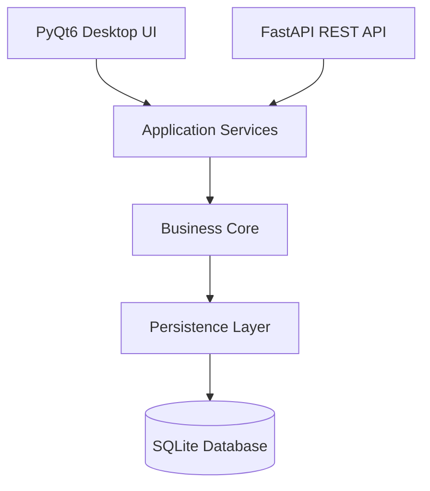
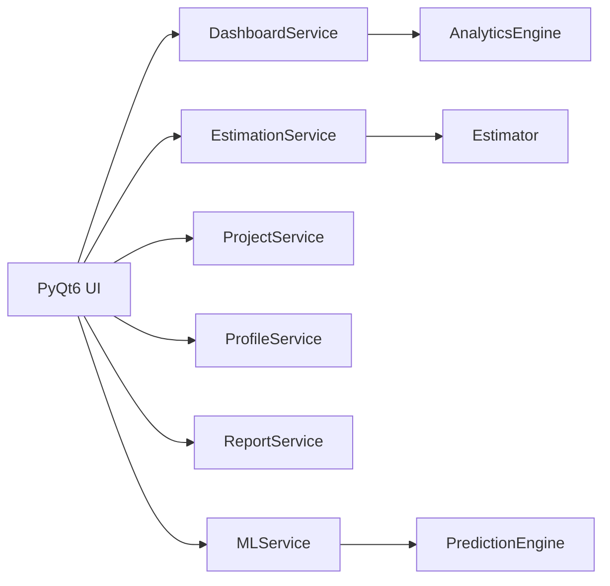
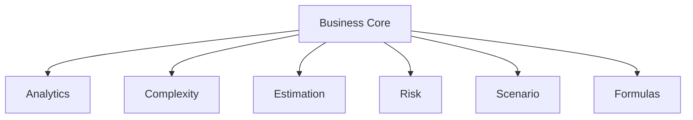
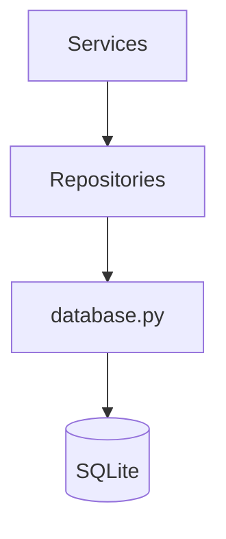
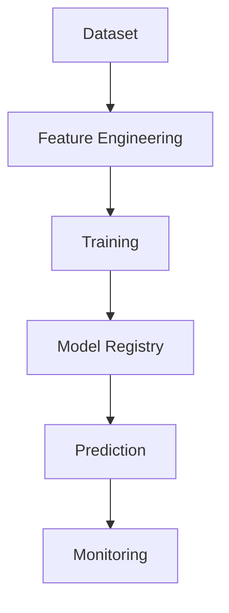
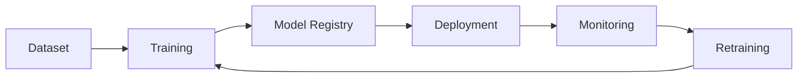
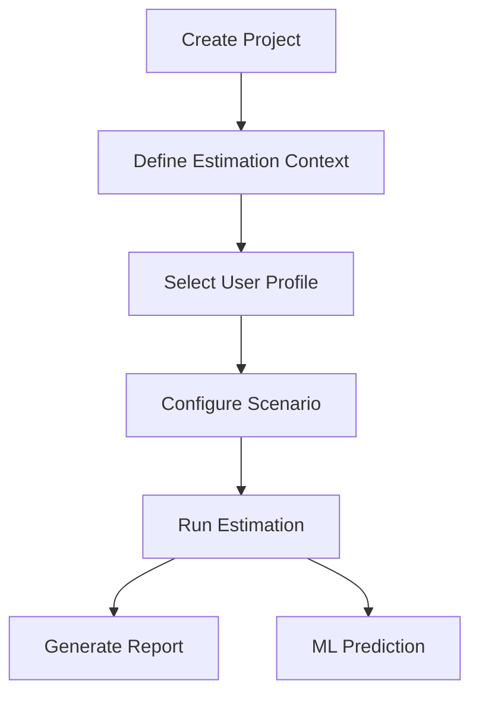

# EstimateFlex Architecture

## Purpose

EstimateFlex is a desktop and API platform dedicated to engineering effort estimation.

The application can be used for:

- Engineering studies
- Flexibility calculations
- Mechanical calculations
- Technical documentation
- Python automation projects
- Data analytics projects
- Technical audits

---

# Global Architecture



---

# Architecture Principles

EstimateFlex follows a layered architecture:

```text
Presentation Layer
        ↓
Service Layer
        ↓
Business Core
        ↓
Persistence Layer
        ↓
Database
```

This approach guarantees:

- Separation of concerns
- Maintainability
- Testability
- Scalability
- Extensibility

---

# Layer Description

## UI Layer

Location:

```text
src/ui/
```

Responsibilities:

- User interaction
- Data entry
- Dashboard visualization
- Reporting
- Scenario management

Technology:

- PyQt6

---

## API Layer

Location:

```text
src/api/
```

Responsibilities:

- REST API
- Integration with external systems
- Automation
- Future web integration

Technology:

- FastAPI

---

## Service Layer

Location:

```text
src/services/
```

Responsibilities:

- Application workflows
- Business orchestration
- Validation
- Communication between modules

Examples:

- EstimationService
- ProjectService
- MLService
- ReportService

---

# Service Architecture



---

## Core Layer

Location:

```text
src/core/
```

Responsibilities:

- Estimation engine
- Complexity evaluation
- Risk computation
- Productivity calculations
- Analytics

Modules:

```text
analytics/
complexity/
estimation/
formulas/
risk/
scenario/
```

---

# Core Architecture



---

## Persistence Layer

Location:

```text
src/persistence/
```

Responsibilities:

- SQLite access
- CRUD operations
- Repository pattern
- Database migrations

Components:

```text
database.py
migration_manager.py
```

Repositories:

```text
project_repository.py
profile_repository.py
prediction_repository.py
settings_repository.py
```

---

# Persistence Architecture



---

# Machine Learning Architecture

Location:

```text
src/ml/
```

Responsibilities:

- Dataset preparation
- Feature engineering
- Model training
- Prediction generation
- Model evaluation



---

# MLOps Layer

Location:

```text
src/mlops/
```

Responsibilities:

- Experiment tracking
- Model versioning
- Monitoring
- Pipeline orchestration

Modules:

```text
experiment_tracker.py
model_versioning.py
model_monitor.py
pipeline.py
```

---

# MLOps Lifecycle



---

# Reporting Architecture

Supported formats:

- Excel
- PDF
- HTML
- PowerPoint

Location:

```text
src/reports/
```

Modules:

```text
excel_report.py
pdf_report.py
html_report.py
pptx_report.py
report_generator.py
```

---

# Business Workflow



---

# Core Business Formula

EstimateFlex is built around four engineering dimensions:

- Volume
- Complexity
- Risk
- Productivity

Primary Formula:

```text
Effort = Volume × Complexity × Risk ÷ Productivity
```

Derived Metrics:

```text
Cost = Effort × Hourly Rate

Duration = Effort ÷ Available Capacity
```

---

# Development Principles

- Separation of concerns
- Dependency inversion
- Repository pattern
- Domain-oriented design
- Testability
- Extensibility
- Maintainability
- Scalability

---

# Technology Stack

| Layer | Technology |
|---------|---------|
| UI | PyQt6 |
| API | FastAPI |
| Database | SQLite |
| Analytics | Pandas |
| Machine Learning | Scikit-Learn |
| Reporting | OpenPyXL / ReportLab / python-pptx |
| Packaging | PyInstaller |
| Containerization | Docker |
| CI/CD | GitHub Actions |

---

# Future Roadmap

## Short Term

- Estimation Engine
- Dashboard
- Reporting
- Historical Database

## Medium Term

- Machine Learning Predictions
- Explainable AI
- Scenario Comparison
- Model Registry

## Long Term

- Cloud Deployment
- Multi-user Environment
- Web Platform
- Full MLOps Automation

---

# Conclusion

EstimateFlex is designed as a modular and scalable engineering estimation platform.

The architecture separates business logic from presentation, persistence and machine learning concerns, enabling future growth toward advanced analytics, predictive estimation and cloud-native deployment.
